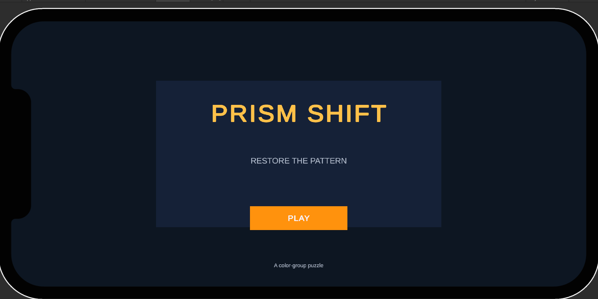
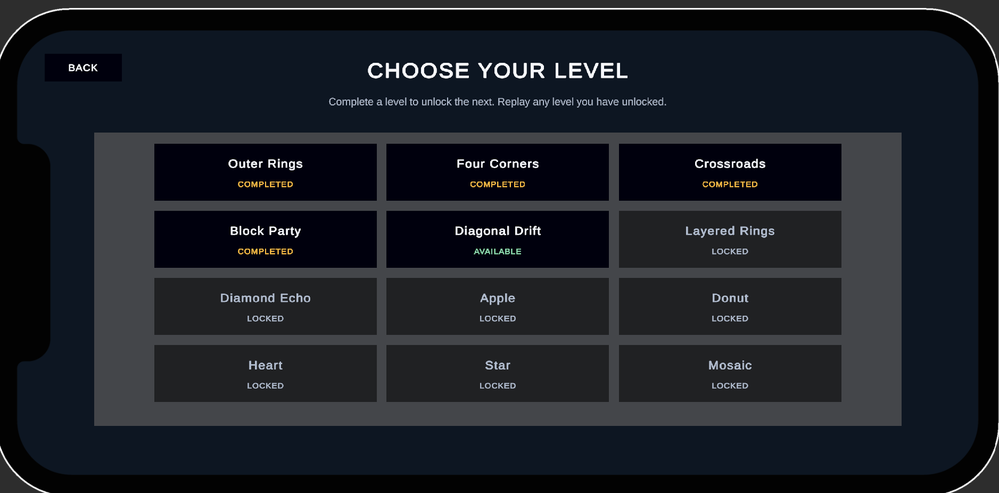
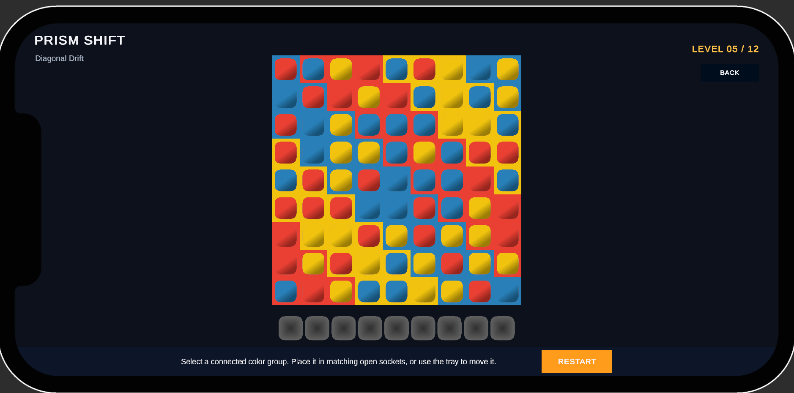

# Prism Shift | Unity 2D Puzzle Game

A 2D color-matching puzzle game built with **Unity and C#**, featuring data-driven level generation, tile interactions, and persistent progression.

**[▶ Gameplay Demo](https://youtu.be/O_D6rRu9gMw)** | **[GitHub Repository](https://github.com/laxmiShrigiri/PrismShift)**

## Gameplay Preview

### Home Scene

### Level Selection

### Gameplay Scene

## Key Features

- **Data-Driven Levels:** Generate puzzle layouts using PNG pixel data and ScriptableObjects.
- **Color Group Detection:** Find connected matching-color groups across eight directions.
- **Tile & Tray Mechanics:** Manage tile movement, board slots, and tray interactions.
- **Level Progression:** Level selection, unlocking, and persistent progress.
- **Save & Resume:** Save and restore gameplay snapshots.
- **Zoom & Pan:** Mouse-wheel and touch-based board navigation.
- **Custom Editor Tool:** Validate level configurations using a custom Unity Editor window.
- **Automated Tests:** Edit Mode tests for selected gameplay and persistence logic.

## Tech Stack

- Unity, C#
- ScriptableObjects and PNG pixel data
- PlayerPrefs
- Unity Test Framework
- Custom Unity Editor tooling
- Git and GitHub

## Code Organization

| System | Main Scripts |
|---|---|
| Board Search | `PuzzleBoardSearch` |
| Tile & Tray | `Tile`, `BoardSlot`, `TraySlot`, `TrayManager` |
| Level Flow | `LevelManager`, `LevelSelectionController` |
| Persistence | `GameSession`, `LevelProgressStore`, `LevelSnapshotStore` |
| Editor Tool | `PrismShiftLevelValidatorWindow` |

## About Me

Unity developer with **2.5 years of professional experience** developing and maintaining 2D mobile applications using Unity and C#.

This project demonstrates my skills in gameplay programming, reusable systems, data-driven design, persistence, and automated testing.

**GitHub:** [Laxmi Shrigiri](https://github.com/laxmiShrigiri)
